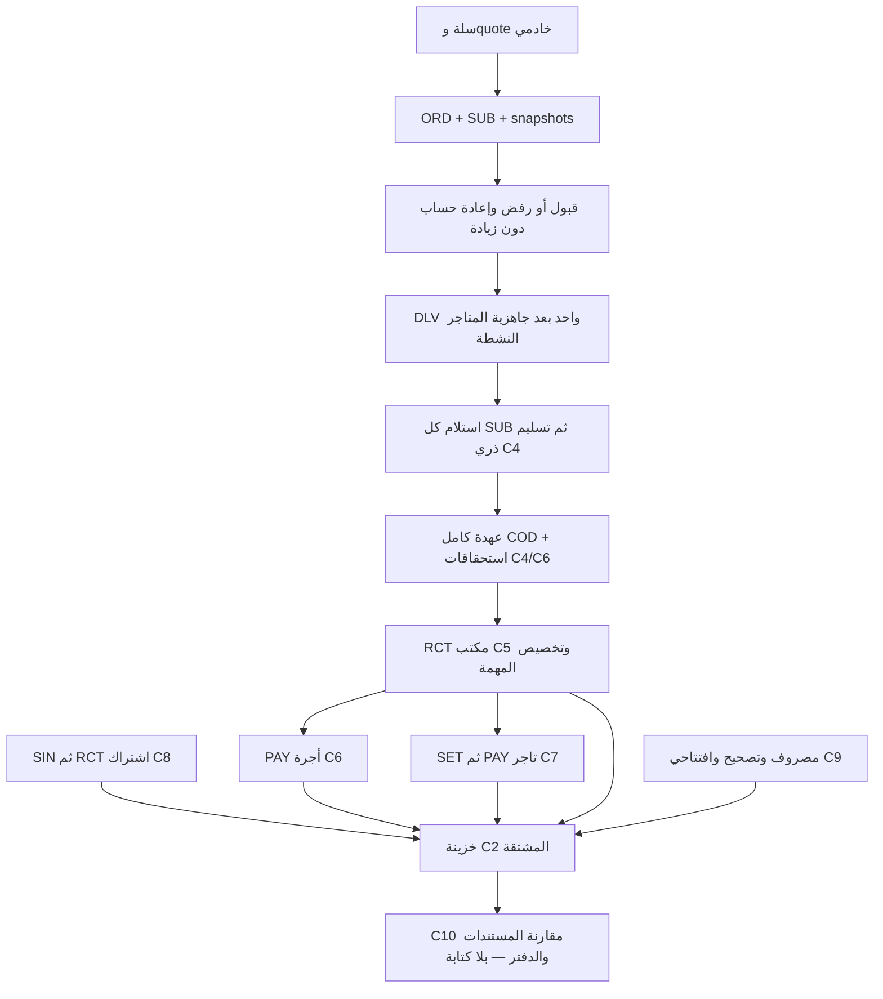

# C10 — التكامل المالي وتوحيد العقود

## القرار وحدود الإثبات

تنفيذ محلي للمراجعة: READY FOR OWNER REVIEW، وليس تصريح تطبيق أو تفعيل. لم يحدث اتصال بـSupabase أو تطبيق Migration أو تشغيل Metro/Web. لا C11/C12 ولا ترحيل بيانات legacy ولا تغيير معادلات مالية معتمدة.

C2 وC3 مطبقتان سابقًا حسب سياق المالك، ولم تتغير ملفاتهما. C4–C9 مسودات محلية، وأضيفت `20261113000100_finance_c10_reconciliation.sql` بعد ترحيلَي C9. C10 تضيف صلاحية قراءة افتراضيًا false وإسقاطات وفحص مطابقة؛ لا تنشئ كاتبًا ماليًا ولا تصلح قيدًا تلقائيًا. لا يُدعى اجتياز PostgreSQL/JWT/COMMIT أو التزامن الفعلي قبل تشغيل الأدوات المعزولة.

## مصادر الحقيقة والكاتب الواحد

`src/lib/finance-integration-contract.ts` يسجل 12 حدثًا ماليًا و48 RPC حساسة ومصفوفة صلاحياتها وترتيب 12 ملفًا من C2 إلى C10. هو جرد مصدر مُراجع، لا تفويض عميل ولا أنواع Supabase مولدة.

- C2: القيود المرحلة والعمليات المكتملة مصدر الحقيقة المالي؛ الأحداث والمراجع والعمليات append-only. كل قيد له TXN مستقل.
- C3: snapshot الموافقة الأصلي لا يتغير؛ current هو مبلغ COD الجاري المعتمد، وليس proposed ولا إجمالي الكتالوج. الحارس دفاعي ضد الزيادة فقط.
- C4: الكاتب الثابت المختار عند إنشاء الطلب (`legacy` أو `c4`). الاستلام لكل SUB، ثم حدث قبض كامل + حدث تسليم وقيدان متوازنان في العملية نفسها. Dr driver_cash / Cr customer_advance، ثم Dr customer_advance / Cr مستحقات التجار والعمولة وإيراد التوصيل. lifecycle تدقيق تشغيلي منفصل عن financial_events، وليس كاتبًا ثانيًا.
- C6 داخل امتداد C4: لقطة نسبة الأجر عند ميلاد DLV، ثم Dr driver_earnings_expense / Cr driver_earnings_payable. C7 لا تعيد هذا القيد ولا قيد مستحقات التجار.
- C5: الطلب يحجز المتاح ولا يدخل نقدًا؛ RCT المؤكد فقط Dr treasury_cash / Cr driver_cash. لا خصم أجر من العهدة.
- C6: الأجرة لا تتاح حتى تخصيص RCT لكامل نقد المهمة؛ PAY فقط Dr driver_earnings_payable / Cr treasury_cash.
- C7: metadata لكل SUB تثبت gross/rate/commission/net من قيد C4؛ SET يحجز المستحقات بلا صرف. PAY: Dr merchant_sales_payable / Cr treasury_cash. الاشتراك مستقل.
- C8: SIN Dr subscription_receivable / Cr subscription_revenue؛ RCT Dr treasury_cash / Cr subscription_receivable مع تفعيل الفترة التشغيلية في المعاملة نفسها. ليس خصمًا من مستحق المبيعات.
- C9: مصروف PAY، وتصحيح/افتتاحي ADJ، تقابل حساباتها المعتمدة الخزينة. اعتماد المصروف ليس نقدًا. الجرد ليس قيدًا. opening_balance_equity حقوق ملكية لا إيراد تشغيل.
- التسليم الصفري بعد رفض متجر: تشغيل/تدقيق فقط، دون قبض أو عهدة أو قيد صفري؛ لا يؤخذ رقم صفري من التطبيق.



## دورة الاشتراك مقابل أهلية المتجر

الفاتورة لها دين وحالة سداد؛ الفترة المدفوعة لها بداية ونهاية؛ الأهلية تضيف حالة المتجر وحساب C8 وحالات التعليق. هذه حالات مختلفة لا تُستبدل ببعضها. automatic يصدر فاتورة ولا يسحب نقدًا. manual/disabled لا يمحوان الدين. توجد فاتورة واحدة غير محصلة دون تكديس فترات مستقبلية.

السماح 168 ساعة فعلية. السداد المبكر/داخل السماح يبدأ عند نهاية الفترة السابقة، وعند168 ساعة أو بعدها يبدأ عند القبض. C8 تحفظ snapshot الخطة والنسبة، وتستخدم UTC للأشهر. بوابتها تمنع **الجديد فقط**؛ لا تدخل في تسليم C4 المقبول سابقًا. إغلاق قبول مجموعات C8 جديدة لا يخرج الأعضاء الحاليين من البوابة ولا يفتح متاجرهم تلقائيًا. لا مجدول مسجل في هذه المرحلة؛ المجدول الخاص يتطلب جلسة مالك قاعدة موثوقة وauth.uid فارغًا، ولا ينتحل JWT.

## المطابقة الفعلية في C10

الإسقاطات الخاصة:

- c10_expected_lines: التوقع من مستندات C4–C9، بإشارة مدين ناقص دائن، وبُعد السائق/العميل/التاجر الصحيح.
- c10_account_comparison: مقارنة تلك القيم مع C2 المرحّل والمكتمل. لا مجموع مركب يخلط النقد والذمم والالتزامات. SIN غير المقبوضة تبقى ذمة وإيرادًا غير نقدي.
- c10_required_references: ORD/SUB/DLV/RCT/PAY/SET/SIN/ADJ/TXN المستحقة للمستندات الجديدة.
- c10_reconciliation_issues: توازن ودقة القيود، الأحداث بلا ترحيل، العمليات المعلقة، المراجع والآباء، التسليم المبكر/قبل الاستلام/أثناء المراجعة، الأثر الصفري، ازدواج legacy، تخصيصات RCT، الأجور واستيفاء العهدة، بيانات عمولة SUB، فترة الاشتراك المقبوضة، وحالات مستندات C9.

`read_financial_reconciliation(expected_user,page_number,scope_value)` دالة STABLE/SECURITY DEFINER بمسار فارغ، SELECT فقط، تتحقق من admin وfinance_private.c10_permissions.may_reconcile وهو false افتراضيًا. لا يمنحها التطبيق ولا دور admin وحده. النتيجة تحمل snapshot/وقتًا ومجاميع جميع النطاقات وصفحة20؛ الفلاتر لا تغير الإجمالي العام. لا يأخذ التقرير أقفال كتابة ولا ينفذ auto-repair.

كل القراءة في Snapshot أمر ثابت. ليست تقرير جرد مادي ولا إثبات تزامن؛ تقرير نظيف يعني عدم وجود اختلاف **ضمن الكواشف الحالية وفي هذه اللقطة فقط**. الأرصدة المعروضة للمقارنة signed debit-minus-credit، بينما قيم فحوص الأجور/المهام مبالغ المصدر لا اتجاه حساب.

الحسابات المعتمدة ذات الحركات اليدوية خارج مصادر C4–C9، أو عكس مصدر مالي دون عقد تشغيلي مطابق، ستظهر للمراجعة. حسابا authorized_suspense مستثنيان من مقارنة مصدر مستقل، لكن تأثير حركتهما على treasury/driver_cash وغيرها يظل مكشوفًا. لا يُخفى فرق بتغيير المتوقع أو بافتتاحي legacy؛ لا تعديل للقيود السابقة. المهام التي لم تُقبل في C6 عند ميلادها تظهر warning، لا يُنشأ لها أجر رجعي.

## تعارضات مثبتة عولجت

1. C3 checkout وC4 pickup/collection كانت تستخدم RPC بلا حد انتظار، بينما C5–C9 تستخدم transport مشتركًا. رُبطت المسارات نفسها بمهلة15 ثانية UNKNOWN، مع احتفاظ المحاولة والمفتاح، واستعادة قبل إعادة الإرسال. انتهاء المهلة لا يلغي معاملة الخادم ولا ينشئ مفتاحًا جديدًا. نموذج المحاولة وعقود SQL لم يتغيرا.
2. توحيد FinancialRpcReply يحافظ على error.code اختياريًا في الخطأ الحقيقي والمهلة ورفض Promise، دون ادعاء أن 42883 يعني غياب ترحيل كامل.
3. لوحة الإدارة القديمة كانت تعيد module cache غير مقيد بالحساب ويمكن لاستجابة متأخرة استبدال قراءة أحدث. أزيل cache الشاشة واستُخدم useCustodyRead/FinancialReader المشترك مع هوية قبل الشبكة وبعدها وkey الحساب وتجاهل استجابات النطاق السابق. أصبحت روابط الخزينة والمطابقة متاحة حتى عند تعثر تحميل مؤشرات legacy.
4. صفحات التقارير القديمة كانت تحمل عناوين عامة قد توحي أنها تشمل C2–C9. صارت موسومة legacy بوضوح مع روابط القراءة الجديدة؛ لا جمع بين المصدرين ولا إعادة تصميم شامل.

لم يظهر تعارض حسابي مثبت يقتضي تعديل صيغ C4–C9 أو امتداداتها. الفحوص المصدرية تراجع أن آخر c4_defer_extensions يشمل C6 وC7، وأن c4_delivery_extensions هو كاتب الأجر الوحيد وأن c7_capture metadata فقط. إثبات ذلك تحت PostgreSQL يبقى مطلوبًا.

## الأقفال الموحدة

- C3 رفض/جاهزية/قبول وC4 استلام/تسليم: الأب ORD ثم DLV، ثم ما يلزم من تسلسل lifecycle/مصادر العملية. لا خزينة عند قبض العميل؛ النقد عهدة سائق فقط.
- C5 طلب/تأكيد: profile السائق، طلب العهدة، ثم mutex الخزينة عند confirmed، ثم العملية/المرجع. تخصيص RCT يمسك profile نفسه ولا يقفل ORD/DLV. لا قفل أب طلب بعد mutex.
- C6 صرف: profile السائق ثم c6_treasury_mutex، ثم العملية والمستندات.
- C7 صرف: store ثم mutex ثم SET؛ لا قفل FOR UPDATE على merchant بعد mutex.
- C8 قبض: merchant بـNO KEY UPDATE ثم mutex ثم SIN. NKU متوافق مع FK KEY SHARE التي تحتاجها C7.
- C9: mutex ثم مستندات ثابتة/عمليات، دون طلب قفل driver/store/merchant بعده. جسر C5 نفسه مضاف في مسودة C9 الأولى.
- C10: SELECT ثابت فقط، لا أقفال مالية جديدة.

لا تُشغّل أي معاملة تجمع يدويًا عدة جهات بعكس هذا الترتيب. الأدوات تشاهد pg_blocking_pids قبل COMMIT، ولا تعد Promise.all أو نجاح JavaScript إثبات تزامن. لا ضمان runtime دون تشغيل الاختبارات على كامل المخطط والمشغلات المؤجلة.

## الصلاحيات وحدود RLS

48 RPC وجميع مجموعات الوصول موثقة في مصفوفة المصدر أدناه. الكتابة الحساسة تحتاج التفويض المستقل لكل مرحلة والملكية والإسناد، وليس إخفاء زر فقط. raw C2 ما زالت تسمح SELECT لـadmin عبر is_admin وفق عقد C2 المعتمد؛ تفويض C10 يحمي RPC التقرير ولا يُدعى أنه ألغى قراءة admin الخام السابقة. لم تُوسّع قراءة إجماليات الطلب للتاجر.

العميل يرى طلبه، والتاجر يرى SUB ومستحق متجره ولا يرى parent pricing، والسائق المسند يرى COD وأجوره وعهدته؛ غير المسند لا يرى طلبًا منتهيًا لسائق آخر. RPC الاستعادة ترجع نتيجة صاحبها فقط. native updates للعميل والدور والبريد ليست جزء C10. C9 المالك يحتاج mapping خادميًا + opening_approve + تأكيد صريح ومقدم طلب مختلف؛ defaults فارغة/false. PUBLIC/anon/service_role لا تملك تنفيذ الدوال الخاصة أو كتابة جداول الدفتر. فحص catalog ليس اختبار JWT.

## ترتيب التطبيق والمخطط

ترتيب الملفات الـ12 في financeMigrationOrder هو المرجع المحلي. C2/C3 لا يعاد تعديلهما أو تطبيقهما كأنهما جديدتان؛ يتحقق المالك من السجل الفعلي. ملفات C4–C10 تأتي تصاعديًا بعدهما. لا تتضمن C10 إيقاف الكاتب القديم أو تشغيل flags أو cron أو تعديل schema الأنواع المالية. العقود الجديدة handwritten معلنة، وتوليد أنواع Supabase الرسمي ينتظر قاعدة مطبقة وإذن اتصال لاحق.

`supabase/verification/finance_c10_readiness.sql` للقراءة فقط: BEGIN READ ONLY، SELECT وROLLBACK. يعرض المطابقة والبوابات وRLS وGRANT/REVOKE وsearch_path، ولا يستدعي أي RPC مالي كاتب أو set_config/nextval. المقارنات تعتمد فقط على helpers SELECT ثابتة موثقة في المصدر. لم يُشغّل على قاعدة بعيدة أو محلية في هذه الجولة.

## الاختبارات المعزولة — تجهيز لا ادعاء تنفيذ

الاختبارات المحلية تشغّل DTOs وtransport والمحاولات الفعلية داخل mock، وتفحص ترتيب المصدر وتوحيد الكاتب. لا تمثل ترحيل SQL. أدوات PostgreSQL لا تقبل إلا numeric loopback وقاعدة منتهية `_c2_test` مع manifest مثبت OID/system identifier/token ومسار psql مطلق موجود مسبقًا. لا تثبيت خدمات، ولا migrations/reset/seed/إنشاء Auth users تلقائيًا.

C10 PostgreSQL تتطلب كل المخطط مطبقًا محليًا بواسطة المالك، دفترًا اصطناعيًا أوليًا بلا financial_events، وfixtures:

- بيانات C2 القياسية، ومنها customer وdriver وadmin، وc4OtherDriver موجود مختلف.
- c8: merchant/owner/store/plan/product حديثة صالحة للتسجيل بلا legacy دين/فترة سارية، وexpiredMerchant/expiredOwner اصطناعيان مدفوعان سابقًا وانتهى سماحهما.
- c3Products[1]: منتج متاح لمتجر وتاجر ومالك آخر؛ الخطة الأصلية فعالة ونسبة عمولتها من0 إلى أقل من100 لضمان مستحق موجب للاختبار.
- c9Completion: approver وowner حسابا admin مختلفان عن admin وعن بعضهما، للقبول المستقل واختبار الافتتاحي.

```powershell
$env:C2_ALLOW_DISPOSABLE_TEST='yes'
$env:C10_ALLOW_DISPOSABLE_TEST='yes'
$env:C2_TEST_MANIFEST='C:\absolute\disposable-manifest.json'
# C2_TEST_DATABASE_URL يخص القاعدة المعزولة فقط، ولا يُطبع أو يُحفظ في المستودع.
node scripts/test-finance-c10-postgres.cjs
```

تتحقق الأداة من هوية القاعدة في كل اتصال قبل الاختبار. تنفذ suite C8 الأصلية بـrollback (المجدول/الانتهاء/الأمان)، ثم اختبار افتتاحي C9 بـrollback، ثم رحلة C10 بـrollback، ثم الرحلة نفسها بـCOMMIT فعلي. تحتوي الرحلة على تجار فعليين وRPC إنشاء/جاهزية/قبول/استلام وتسليم، قبض اشتراك وتفعيل، تعليق يمنع الجديد دون القديم، RCT جزئي ثم كامل، صرف أجر وSET/PAY، مصروف وجرد وتصحيح، صفر بعد رفض، رفض الجميع دونDLV، legacy بعد إعادة فتح العلم، واستعادة طلب قديم دون مسح سلة جديدة.

يُحقن قيد C2 متوازن لكنه غير مسنود بعملية تشغيلية **داخل subtransaction اختبارية فقط** لإثبات أن reconciliation يكشف فرق treasury، ثم يتراجع كله. ويُحقن فشل مؤجل بعد إثبات أن C7 capture نُفذت، فتُفحص عودة C4/C6/C7 كلها إلى الحالة السابقة قبل إعادة المحاولة بالمفتاح نفسه.

بعد COMMIT: تأكيدان C5 متداخلان لنفس الطلب، ثم صرف C6 وصرف C7 بجهتين مختلفتين يشتركان في mutex؛ تُشاهد حالة الانتظار ويُفحص دفتر فعلي ومطابقة نهائية. لا SKIP عند غياب البيانات. تبقى السجلات الاصطناعية للتدقيق، وتغلق جميع بوابات الكتابة في finally. sequences لا تتراجع بـROLLBACK، لذلك يحظر استعمال هذه الملفات على المشروع الأساسي.

JWT الحقيقي: `scripts/test-finance-c10-jwt.cjs` يعيد استخدام حارس C9 وAuth المحلي الحقيقي والربط بسجل في القاعدة المثبتة. يحتاج C10_JWT_ALLOW_DISPOSABLE_TEST=yes وC9_JWT_ALLOW_DISPOSABLE_TEST=yes وبيئة C9 JWT الموثقة، وmay_reconcile لـADMIN فقط. يختبر C9 ثم رفض C10 لبقية الأدوار/admin غير المفوض/الهوية المزورة. لا يفتح بوابات أو يمنح صلاحيات أو يقبل Supabase مستضافًا. لم يُشغّل هنا، ولا يغني عن اختبار الهاتف أو التزامن.

## ما بقي وترتيب الاعتماد

لا تعارض مالي أو قرار تسعير جديد مفتوح من مراجعة المصدر. توجد حدود إثبات: PostgreSQL الحقيقي/المشغلات المؤجلة/الأقفال وHTTP JWT والهاتف وتوليد الأنواع الرسمية لم تُنجز بهذه الجولة. يخضع أثر أقفال FK الضمنية وكلفة التجميع على بيانات كبيرة للاختبار الفعلي. لا يُستبدل ذلك بنجاح TypeScript.

المتبقي من legacy هو العقد القديم والواجهات الموسومة ومصادره وصلاحياته؛ لم تُنقل أرصدته أو طلباته إلى C2، ولم ينشأ dual writer. C11 مرحلة مستقلة لاحقًا. إجراء المالك التالي: مراجعة الملفات وتشغيل الأداة على البيئة الاصطناعية المعزولة، ثم اعتماد النتيجة؛ لا تفعيل مالي تلقائي بعد C10.

## مصفوفة المصدر التفصيلية

- authenticated profile; result actor=auth.uid
  - get_c2_financial_operation — supabase/migrations/20261105000100_finance_c2_foundation.sql:547
- admin
  - find_c2_document_reference — supabase/migrations/20261105000100_finance_c2_foundation.sql:561
  - save_c3_delivery_zone — supabase/migrations/20261106000100_finance_c3_delivery_pricing.sql:901
  - get_c3_pricing_exceptions — supabase/migrations/20261106000100_finance_c3_delivery_pricing.sql:998
- customer + expected_user=auth.uid + own server cart/request; C8 eligibility for NEW creation only
  - quote_c3_cart — supabase/migrations/20261111000100_finance_c8_subscriptions.sql:359
  - create_c3_order_from_cart — supabase/migrations/20261111000100_finance_c8_subscriptions.sql:275
  - recover_c3_order_request — supabase/migrations/20261106000100_finance_c3_delivery_pricing.sql:877
- customer owner / own store projection / assigned driver / admin; reference fields filtered by party
  - get_c3_order_context — supabase/migrations/20261106000100_finance_c3_delivery_pricing.sql:924
- own store merchant or admin; fixed lifecycle; C3 rejection/dispatch guards
  - update_store_order_status — supabase/migrations/20261106000100_finance_c3_delivery_pricing.sql:706
- own customer order; post-dispatch cancellation guarded
  - cancel_customer_order — supabase/migrations/20261106000100_finance_c3_delivery_pricing.sql:733
- legacy admin only; C4 commission explicitly refused; no C2 reversal exposed
  - reverse_store_order_commission — supabase/migrations/20261107000300_c4_atomic_delivery_collection.sql:22
- approved driver; existing availability/assignment + review guard
  - accept_delivery_task — supabase/migrations/20261106000100_finance_c3_delivery_pricing.sql:747
- existing assigned-driver/admin scope; C4 disallows old pickup/delivery transitions
  - update_delivery_task_status — supabase/migrations/20261107000200_c4_store_pickups_review_gate.sql:110
- approved driver + expected_user + assignment; pickups/version/review guards
  - get_c4_pickup_context — supabase/migrations/20261107000200_c4_store_pickups_review_gate.sql:161
  - confirm_c4_store_pickup — supabase/migrations/20261107000200_c4_store_pickups_review_gate.sql:124
  - complete_delivery_and_collect_cash — supabase/migrations/20261107000300_c4_atomic_delivery_collection.sql:157
- expected_user=auth.uid; persisted actor-owned result only
  - recover_delivery_collection — supabase/migrations/20261107000300_c4_atomic_delivery_collection.sql:257
  - recover_c5_cash_handover — supabase/migrations/20261108000100_finance_c5_driver_cash_handover.sql:223
  - recover_c6_operation — supabase/migrations/20261109000100_finance_c6_driver_wages.sql:290
  - recover_c7_operation — supabase/migrations/20261110000100_finance_c7_merchant_settlements.sql:182
  - recover_subscription_operation — supabase/migrations/20261111000100_finance_c8_subscriptions.sql:270
- approved driver + expected_user + own ledger custody/reservations
  - request_c5_cash_handover — supabase/migrations/20261108000100_finance_c5_driver_cash_handover.sql:136
- admin + c5_cash_receivers.enabled + exact count
  - confirm_c5_cash_handover — supabase/migrations/20261109000100_finance_c6_driver_wages.sql:187
- own driver or admin + expected_user
  - get_c5_driver_custody — supabase/migrations/20261108000100_finance_c5_driver_cash_handover.sql:231
  - get_c6_driver_wages — supabase/migrations/20261109000100_finance_c6_driver_wages.sql:307
- admin + expected_user; write permissions independently checked
  - list_c5_cash_requests — supabase/migrations/20261108000100_finance_c5_driver_cash_handover.sql:258
  - get_c6_wage_policy — supabase/migrations/20261109000100_finance_c6_driver_wages.sql:297
  - list_c6_driver_wages — supabase/migrations/20261109000100_finance_c6_driver_wages.sql:333
  - list_c7_merchant_settlements — supabase/migrations/20261110000100_finance_c7_merchant_settlements.sql:213
  - list_subscription_accounts — supabase/migrations/20261111000100_finance_c8_subscriptions.sql:391
- admin + may_edit_policy
  - save_c6_wage_policy — supabase/migrations/20261109000100_finance_c6_driver_wages.sql:226
- admin + may_pay_wages; full task cash settled; treasury available
  - pay_c6_driver_wages — supabase/migrations/20261109000100_finance_c6_driver_wages.sql:260
- own merchant/store or admin + expected_user; no cross-store projection
  - get_c7_merchant_settlements — supabase/migrations/20261110000100_finance_c7_merchant_settlements.sql:186
  - read_subscription_account — supabase/migrations/20261111000100_finance_c8_subscriptions.sql:367
- admin + may_prepare; delivered, available full SUBs
  - prepare_c7_settlement — supabase/migrations/20261110000100_finance_c7_merchant_settlements.sql:126
- admin + may_pay; SET uniqueness + treasury available
  - pay_c7_settlement — supabase/migrations/20261110000100_finance_c7_merchant_settlements.sql:156
- admin + plans
  - save_subscription_plan_version — supabase/migrations/20261111000100_finance_c8_subscriptions.sql:133
- admin + issue; explicit enrollment and no historical debt/current period
  - enroll_subscription_account — supabase/migrations/20261111000100_finance_c8_subscriptions.sql:143
- actual merchant owner for renewal mode; admin issue/suspend/resume/cancel respectively
  - change_subscription_account — supabase/migrations/20261111000100_finance_c8_subscriptions.sql:153
- actual merchant owner in manual mode OR admin + issue; one unpaid anchor
  - issue_subscription_invoice — supabase/migrations/20261111000100_finance_c8_subscriptions.sql:197
- admin + collect; full invoice count; treasury mutex; native activation atomic
  - collect_subscription_invoice — supabase/migrations/20261111000100_finance_c8_subscriptions.sql:211
- admin + section-specific c9_permissions; audit does NOT post money
  - record_treasury_action — supabase/migrations/20261112000100_finance_c9_treasury.sql:88
  - read_treasury_control — supabase/migrations/20261112000100_finance_c9_treasury.sql:138
- admin + category-specific request/read authority
  - request_treasury_finance — supabase/migrations/20261112000200_finance_c9_posting.sql:132
  - read_treasury_finance — supabase/migrations/20261112000200_finance_c9_posting.sql:227
- admin + approve/pay; never self approve; counter excluded; opening needs mapped owner + confirmation
  - act_on_treasury_finance — supabase/migrations/20261112000200_finance_c9_posting.sql:175
- admin + expected_user + own completed/rejected operation
  - recover_treasury_action — supabase/migrations/20261112000100_finance_c9_treasury.sql:133
- admin + c10_permissions.may_reconcile; read-only snapshot
  - read_financial_reconciliation — supabase/migrations/20261113000100_finance_c10_reconciliation.sql:108

## نتائج الفحوص المحلية النهائية

نجحت 16 مجموعة محلية: 308 اختبارات وفحوص مرقمة، بالإضافة إلى مجموعتي عقود التقارير والحساب المالي للتاجر غير المرقمتين. منها 20 اختبار C10 جديدًا. نجح TypeScript وdiff whitespace وفحص صياغة أدوات C10. Lint: صفر أخطاء وستة تحذيرات سابقة خارج نطاق C10. PostgreSQL وJWT وCOMMIT والتزامن الفعلي لم تُنفذ. لا يوجد psql/postgres على PATH؛ لم يُنشأ اتصال أو بيانات اختبار. لا تعني هذه النتائج نجاح المطابقة على قاعدة فعلية.
