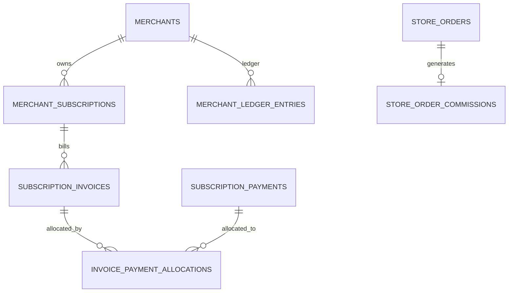

# نموذج البيانات المقترح

## توسعات مقترحة

- `subscription_plans`: نوع الرسم، `commission_rate`, `features jsonb`, `product_limit`.
- `merchant_subscriptions`: حالة الفترة، تجديد تلقائي، ائتمان مسموح، بداية/نهاية السماح، ولقطات الخطة الكاملة.
- `subscription_invoices`: رقم فريد، التاجر، فترة الاشتراك، العملة، الإجمالي/المدفوع/المتبقي، الاستحقاق والحالة.
- `subscription_payments`: دفعات غير قابلة للحذف منطقيًا، مرجع خارجي اختياري، منفذ الاستلام، تاريخ الدفع والتسجيل، ومفتاح منع التكرار.
- `invoice_payment_allocations`: توزيع دفعة على فاتورة؛ يسمح بالدفعات الجزئية دون تكرار الدين.
- `store_order_commissions`: صف واحد لكل `store_order`، أساس العمولة، النسبة الملتقطة، المبلغ والعملة وحالة التسوية.
- `merchant_ledger_entries`: دفتر غير قابل للتعديل المباشر، يربط الفواتير والدفعات والعمولات والتسويات بالمستند المصدر.

## قواعد مفاتيح أساسية

- `unique(subscription_invoices.subscription_id, invoice_kind)` للفواتير الدورية.
- `unique(store_order_commissions.store_order_id)` للعمولة.
- مفتاح idempotency فريد لكل طلب دفع أو تجديد.

